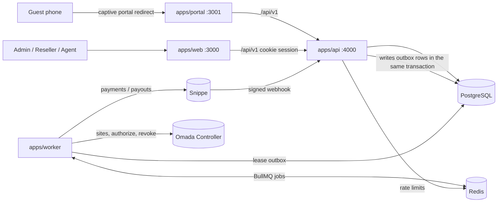

# Architecture

Advo TZ is a **modular monolith**: one PostgreSQL database, one backend codebase (`packages/backend`), and two processes built from it (the HTTP API and the worker), plus two Next.js front ends.

Guest internet traffic never passes through Advo. It flows from the EAP to the ISP. Advo only tells the Controller which client MAC may pass, for how long and at what speed.

## Processes

| Process | Entry | Notes |
|---|---|---|
| API | `apps/api/src/main.ts` | NestJS on Fastify under `/api/v1`. 1 MB body limit, `rawBody` kept for webhook signatures, Helmet, CORS limited to `CSRF_TRUSTED_ORIGINS`. Swagger at `/api/docs` outside production only. |
| Worker | `apps/worker/src/main.ts` | NestJS application context (no HTTP). With `REDIS_URL` set: every second it leases due outbox rows and enqueues one BullMQ job per row (`jobId = <outboxId>-<attempts>`), consumes them with `WORKER_CONCURRENCY` (default 8), and runs the sweeper as a BullMQ job scheduler every 60 s. `REDIS_URL` is required by the config schema, so the inline drain path in the code (every 2 s without Redis) is not reachable through normal startup. On SIGTERM it closes its queues and exits 0. |
| Web | `apps/web` | Marketing, auth, onboarding and the three dashboards. Talks to the API with the session cookie. |
| Portal | `apps/portal` | Captive portal. Server components call the API through `API_INTERNAL_URL`, and browser calls go to `NEXT_PUBLIC_API_URL`. |

The worker never imports `apps/api`. Both import `@advo/backend`.

## Backend modules (`packages/backend/src/modules`)

`auth` (sessions, MFA, invitations) · `admin` · `reseller` · `agent` · `portal` · `catalog` (packages, vouchers) · `access` (grants, grant devices) · `network` (controllers, sites, device claims) · `payments` (attempts, webhook inbox, reconciliation) · `subscriptions` · `commissions` · `ledger` · `withdrawals` (destinations, withdrawals, payouts) · `settings` · `support` · `notifications` · `reports` · `outbox` (dispatcher, handlers, sweepers). Health and metrics live in `src/health`.

## Reliability patterns

- **Transactional outbox.** Every side effect that leaves the database (a payment request, a Controller call, a payout) is written as an `OutboxEvent` in the same transaction as the state change. The worker dispatches it later. Event types: `payment.inbox.received`, `payment.reconcile`, `order.paid`, `grant.authorize`, `grant.revoke`, `subscription.activated`, `site.provision`, `withdrawal.approved`, `payout.reconcile`, `reseller.registered`, `notification.send`.
  - Retries: up to 12 attempts, with backoff of 2 s × 2ⁿ capped at 1 h. After that the event is marked `DEAD:` (see the runbook).
  - Leasing: a dispatcher pushes `nextAttemptAt` forward, so a crashed worker's events reappear automatically.
  - Handlers are idempotent.
- **Webhook inbox.** Snippe webhooks are verified against the raw body and stored (`WebhookInboxEvent`, unique per provider event) before processing, so redelivery is harmless.
- **Sweepers (every 60 s).** They retry inbox events stuck for more than 2 min and look up payment and payout attempts left in `PENDING` or `UNKNOWN` for more than 2 min (the provider lookup is the source of truth). They also release commissions whose hold has ended, expire subscriptions, expire grants and mark failed activations, and delete portal contexts older than 24 h.
- **Unknown is a real state.** A timeout on a money or hardware call becomes `UNKNOWN` and is looked up. It is never treated as success or failure.
- **Idempotency.** Client requests that create orders, withdrawals or checkouts carry an idempotency key. Provider calls use a compact `Idempotency-Key` (at most 30 characters, as Snippe requires).
- **`OUTBOX_INLINE=true`** (development and smoke tests only) dispatches right after commit inside the API process.

## Security model

- **Sessions.** An opaque random token in the `advo_session` cookie (HttpOnly, SameSite=Lax, and Secure in production or when `AUTH_COOKIE_SECURE=true`). Only its SHA-256 hash is stored. Sessions have an absolute lifetime; there is no idle timeout yet.
- **Passwords.** Argon2id (library defaults), 10–128 characters.
- **Admin MFA.** TOTP (RFC 6238, 30 s, ±1 step). Admin routes return `MFA_REQUIRED` until the session has passed MFA. Each code is accepted only once per user: the last accepted time step is stored, and codes at or before it are refused.
- **CSRF.** Every unsafe request that carries the session cookie must have an `Origin` (or `Referer`) in `CSRF_TRUSTED_ORIGINS`. Requests with the cookie but without an origin are refused. The webhook route is exempt, because it uses its signature instead.
- **Tenant isolation.** `resellerId` and `agentId` always come from the session, never from the request body. Every query filters by them, and another tenant's record returns 404. This is covered by integration tests.
- **Rate limits.** Fixed windows in Redis, shared across API replicas, with a per-process memory fallback. See [`permissions.md`](permissions.md#rate-limits).
- **Secrets at rest.** TOTP secrets, Controller credentials and voucher codes are encrypted with `SECRETS_ENCRYPTION_KEY`. Voucher codes are looked up by HMAC (`VOUCHER_LOOKUP_HMAC_KEY`), never by plaintext.
- **Production guards.** The API and worker refuse to start in production with the fake payment provider, placeholder secrets or the memory rate limiter. Creating a FAKE controller is refused in production, and so is using one.

## Configuration

All env is validated by `@advo/config` (Zod) at startup. `@advo/config/load-env` loads the repository root `.env` (or `ADVO_ENV_FILE_PATH`) without overriding variables already set. See `.env.example` for every variable.
